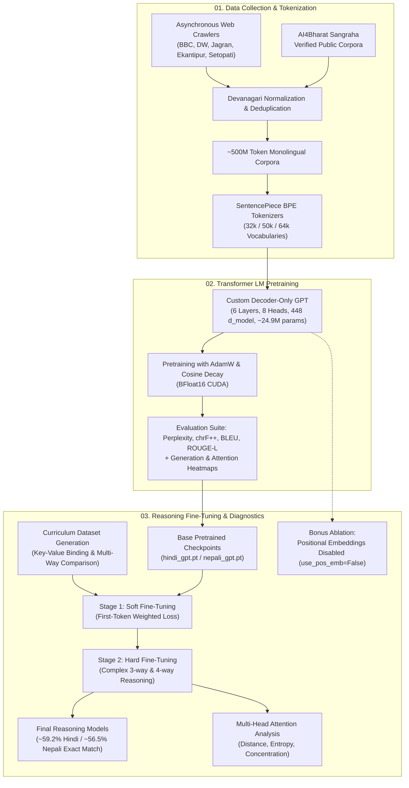

# 🇮🇳 🇳🇵 Indic-LLM: End-to-End Devanagari Language Models (Hindi & Nepali)

[](https://www.python.org/)
[](https://pytorch.org/)
[](https://github.com/google/sentencepiece)
[](https://www.kaggle.com/satyagudu)
[](LICENSE)

An end-to-end framework for developing, pretraining, evaluating, and fine-tuning custom **Decoder-Only Transformer Language Models (GPT, ~24.9M parameters)** from scratch for **Hindi** (higher-resource) and **Nepali** (lower-resource) Devanagari script languages.

---

## 📑 Table of Contents

- [Overview](#-overview)
- [Pipeline Architecture](#-pipeline-architecture)
- [Repository Structure & Module Overview](#-repository-structure--module-overview)
- [01. Data Collection & Tokenization](#01-data-collection--tokenization)
- [02. Transformer LM Pretraining](#02-transformer-lm-pretraining)
- [03. Reasoning Fine-Tuning & Attention Diagnostics](#03-reasoning-fine-tuning--attention-diagnostics)
- [Bonus: Positional Embedding Ablation Study](#bonus-positional-embedding-ablation-study)
- [Benchmark Results & Performance](#-benchmark-results--performance)
- [Datasets & Pretrained Model Downloads](#-datasets--pretrained-model-downloads)
- [Project Reports & Technical Documentation](#-project-reports--technical-documentation)
- [Reproduction Guide](#-reproduction-guide)
- [Author & Acknowledgments](#-author--acknowledgments)

---

## 🌟 Overview

Building performant language models for South Asian languages requires careful handling of Devanagari orthography, conjunct ligatures, and morphologically rich sub-words. This repository presents the complete lifecycle of two independent monolingual language models:
- **Model H (Hindi GPT)**: Higher-resource Devanagari model.
- **Model L / N (Nepali GPT)**: Lower-resource Devanagari model.

The project is structured into three self-contained modules representing the core evolutionary stages of language model development:
1. **`01_Data_Collection_and_Tokenization`**: Large-scale asynchronous web crawling (~100M tokens/language), deduplication with public corpora (~500M tokens total), and SentencePiece BPE tokenizer construction.
2. **`02_Pretraining_Transformer_LMs`**: Clean PyTorch implementation of a 6-layer, 24.9M-parameter causal decoder Transformer trained on BFloat16 CUDA with multi-metric evaluation suites and attention heatmaps.
3. **`03_Reasoning_Finetuning_and_Analysis`**: Two-stage curriculum fine-tuning on multi-entity Devanagari reasoning benchmarks (boosting exact match accuracy from 0% to ~59%), deep multi-head attention diagnostics, and a positional embedding ablation study.

---

## 🔄 Pipeline Architecture



---

## 🗂️ Repository Structure & Module Overview

Rather than generic phase labels, the repository is organized by functional domain:

```text
.
├── 01_Data_Collection_and_Tokenization/   # Web scraping, cleaning, & SentencePiece BPE tokenizers
│   ├── Hindi/                             # Hindi crawler, preprocessing, & tokenizer scripts
│   ├── Nepali/                            # Nepali crawler, preprocessing, & tokenizer scripts
│   ├── report/                            # Dataset statistics, evidence logs, & Phase 1 PDF report
│   └── README.md                          # In-depth Phase 1 documentation & tokenizer analysis
│
├── 02_Pretraining_Transformer_LMs/        # PyTorch GPT architecture & pretraining pipelines
│   ├── hindi/                             # Model H pretraining code, configs, generation, & eval
│   ├── nepali/                            # Model L pretraining code, configs, generation, & eval
│   ├── report/                            # Phase 2 PDF Report (pretraining curves & metrics)
│   └── README.md                          # Architecture specs & pretraining quickstart
│
├── 03_Reasoning_Finetuning_and_Analysis/  # Two-stage fine-tuning, evaluations, & diagnostics
│   ├── Hindi/                             # Hindi soft & hard fine-tuning, eval, & attention plots
│   ├── Nepali/                            # Nepali soft & hard fine-tuning, eval, & attention plots
│   ├── Bonus/                             # Ablation study: Transformer with NO positional embeddings
│   ├── Report/                            # Phase 3 Final PDF Report (reasoning & attention dynamics)
│   └── README.md                          # Fine-tuning methodology, results, & ablation report
│
├── .gitignore                             # Ignores __pycache__, checkpoints, & binary files
└── README.md                              # Master project README & reproduction guide
```

---

## 01. Data Collection & Tokenization

Targeting **~500M tokens per language** with $\ge 20\%$ original manual web crawling and no document or vocabulary overlap between Hindi and Nepali.

### Key Highlights
- **Custom Asynchronous Web Crawlers**: Built with `aiohttp` and `trafilatura` to crawl human-authored editorial content across national news portals, regional dailies, encyclopedic sources, and literary archives (e.g., BBC Hindi/Nepali, DW, Jagran, Setopati, Ratopati, Kavita Kosh).
- **Rigorous Data Preprocessing**: NFC Unicode normalization, line-level and document-level Devanagari character ratio filtering ($\ge 0.80$), URL/boilerplate removal, and SHA-256 exact deduplication.
- **Tokenizer Training**: SentencePiece Byte-Pair Encoding (BPE) trained across 32,000, 50,000, and 64,000 vocabulary sizes.
- **Cross-Lingual Tokenizer Metrics**:

| Language | Target Tokens | Vocab Size | Fertility Rate | UNK Rate | Chars / Token |
| :--- | :--- | :--- | :--- | :--- | :--- |
| **Hindi** | ~500M | 32,000 | 1.341 | 0.28% | 3.82 |
| **Hindi** | ~500M | 50,000 | 1.215 | 0.25% | 4.20 |
| **Nepali** | ~500M | 32,000 | 1.398 | 0.49% | 4.65 |
| **Nepali** | ~500M | 50,000 | 1.242 | 0.43% | 5.20 |

*Detailed report and scripts in [`01_Data_Collection_and_Tokenization/`](file:///01_Data_Collection_and_Tokenization).*

---

## 02. Transformer LM Pretraining

Pretraining custom monolingual decoder-only Transformer language models (GPT) from scratch on raw Devanagari text corpora.

### Architecture Specifications

| Hyperparameter | Value | Description |
| :--- | :--- | :--- |
| **Architecture** | Causal Decoder Transformer | Pre-LayerNorm GPT architecture |
| **Transformer Layers (`n_layers`)** | 6 | Identical for both models |
| **Hidden Dimension (`d_model`)** | 448 | Representation size |
| **Attention Heads (`n_heads`)** | 8 | Multi-head self-attention (`d_head = 56`) |
| **FFN Dimension (`d_ff`)** | 1,024 | Feed-forward intermediate expansion |
| **Sequence Length (`max_seq_len`)** | 512 | Context window |
| **Vocabulary Size** | 32,000 | SentencePiece BPE tokens |
| **Weight Tying** | Enabled | Tied token embeddings and LM head projection |
| **Total Parameters** | **24,919,552** | ~24.9M parameters |

### Features & Evaluation
- **Optimized Memory Pipeline**: Custom memory-mapped binary dataset reader for high-throughput batching.
- **Precision**: Mixed precision training using CUDA `bfloat16`.
- **Decoding Strategies**: Greedy search, nucleus/top-k sampling with temperature control, and beam search.
- **Quantitative Evaluation**: Perplexity tracking, BLEU, chrF, chrF++, ROUGE-L, and token diversity metrics.
- **Attention Heatmaps**: Visualizes layer-wise attention distribution, head specialization, and entropy across token distances.

*Full pretraining configs, training loops, and evaluation scripts in [`02_Pretraining_Transformer_LMs/`](file:///02_Pretraining_Transformer_LMs).*

---

## 03. Reasoning Fine-Tuning & Attention Diagnostics

Pretrained base language models struggle with complex multi-step reasoning out of the box. This module introduces a **Two-Stage Curriculum Fine-Tuning** pipeline specifically designed to instill symbolic and comparative reasoning in low-resource Devanagari models.

### Two-Stage Curriculum Strategy

```
Pretrained Base Checkpoint (0.0% accuracy)
               │
               ▼
   [Stage 1: Soft Fine-Tuning]
   • Direct key-value entity bindings (Entity ➔ Value, Value ➔ Entity)
   • 2-candidate comparisons
   • Loss Multiplier: 3.0x on first answer token
   • Output: soft_best.pt
               │
               ▼
   [Stage 2: Hard Fine-Tuning]
   • Multi-entity comparisons (3-way & 4-way candidate reasoning)
   • Permuted attributes, metric units, and varied candidate positions
   • Output: hard_best.pt (~59.2% Hindi / ~56.5% Nepali accuracy)
```

### Attention Head Diagnostics
Layer-by-layer attention analysis examining:
- **Attention Distance**: How far back attention heads attend as layers deepen.
- **Attention Entropy**: Measures distribution sharpness (diffuse vs. concentrated).
- **Concentration on Key Tokens**: Demonstrates how fine-tuned attention heads sharply align with target entity tokens compared to base models.

*Fine-tuning pipelines, dataset generators, and attention visualization suites in [`03_Reasoning_Finetuning_and_Analysis/`](file:///03_Reasoning_Finetuning_and_Analysis).*

---

## 🔬 Bonus: Positional Embedding Ablation Study

An empirical ablation study investigating Transformer behavior when **learned positional embeddings are completely removed** (`use_pos_emb=False`):
- **Model**: 6-layer GPT trained without positional encodings on the Devanagari reasoning task.
- **Findings**: The model loses sequence-order awareness, resulting in degraded comparative reasoning and higher attention entropy across layers 0 to 5.
- **Visuals**: Full 48-head attention heatmaps and comparative entropy curves are provided in [`03_Reasoning_Finetuning_and_Analysis/Bonus/graphs/`](file:///03_Reasoning_Finetuning_and_Analysis/Bonus/graphs).

---

## 📊 Benchmark Results & Performance

All models were evaluated on 3,000 synthetic multi-entity reasoning test prompts (`hard_test.jsonl`):

### Overall Exact Match Accuracy

| Metric | Hindi Pretrained | Hindi Hard Fine-Tuned | Nepali Pretrained | Nepali Hard Fine-Tuned |
| :--- | :--- | :--- | :--- | :--- |
| **Exact Match Accuracy** | 0.00% | **59.23%** (1,777 / 3,000) | 0.00% | **56.53%** (1,696 / 3,000) |
| **First-Token Accuracy** | 0.00% | **59.23%** (1,777 / 3,000) | 0.00% | **56.53%** (1,696 / 3,000) |

### Task-Wise Accuracy Breakdown

| Task Type | Description | Hindi GPT (Model H) | Nepali GPT (Model N) |
| :--- | :--- | :--- | :--- |
| `bind_entity_to_value` | Direct lookup (Entity $\rightarrow$ Value) | **100.00%** (139 / 139) | **100.00%** (139 / 139) |
| `bind_value_to_entity` | Reverse lookup (Value $\rightarrow$ Entity) | **42.36%** (61 / 144) | **42.36%** (61 / 144) |
| `compare_2way` | 2-Candidate Min/Max Comparison | **73.95%** (369 / 499) | **76.35%** (381 / 499) |
| `compare_3way` | 3-Candidate Min/Max Comparison | **62.79%** (670 / 1,067) | **56.98%** (608 / 1,067) |
| `compare_4way` | 4-Candidate Min/Max Comparison | **46.74%** (538 / 1,151) | **44.05%** (507 / 1,151) |

---

## 💾 Datasets & Pretrained Model Downloads

Pretrained checkpoints and tokenized datasets are hosted on Kaggle:

| Asset | Type | Link |
| :--- | :--- | :--- |
| **Hindi Pretraining Dataset** | Dataset (~500M tokens) | [kaggle.com/datasets/satyagudu/hindi-data-lma](https://www.kaggle.com/datasets/satyagudu/hindi-data-lma) |
| **Nepali Pretraining Dataset** | Dataset (~500M tokens) | [kaggle.com/datasets/satyagudu/nepali-data-lma](https://www.kaggle.com/datasets/satyagudu/nepali-data-lma) |
| **Model H (Hindi GPT Checkpoint)** | Model Checkpoint (~24.9M) | [kaggle.com/models/satyagudu/hindi-gpt-model-h](https://www.kaggle.com/models/satyagudu/hindi-gpt-model-h) |
| **Model L (Nepali GPT Checkpoint)** | Model Checkpoint (~24.9M) | [kaggle.com/models/satyagudu/neplai-gpt-model-l](https://www.kaggle.com/models/satyagudu/neplai-gpt-model-l) |

---

## 📄 Project Reports & Technical Documentation

Comprehensive academic reports documenting experimental methodology, loss curves, and linguistic findings:
- 📑 [Phase 1: Data Collection & Tokenizer Construction Report](file:///01_Data_Collection_and_Tokenization/report/report.pdf)
- 📑 [Phase 2: Decoder-Only Transformer Pretraining Report](file:///02_Pretraining_Transformer_LMs/report/Phase2_Report.pdf)
- 📑 [Phase 3: Multi-Entity Reasoning Fine-Tuning & Attention Diagnostics Report](file:///03_Reasoning_Finetuning_and_Analysis/Report/Phase3_Final_Report.pdf)

---

## ⚡ Reproduction Guide

### Environment Setup
```bash
# Clone the repository
git clone https://github.com/SATYAJIT2747/Hindi-and-Nepali-LLM.git
cd Hindi-and-Nepali-LLM

# Install dependencies
pip install torch torchvision torchaudio --index-url https://download.pytorch.org/whl/cu128
pip install sentencepiece pyyaml tqdm matplotlib numpy
```

### 1. Data Collection & Tokenizer Construction
```bash
# Hindi Pipeline
cd 01_Data_Collection_and_Tokenization/Hindi
python Dataset_collection_script/hindi_web_crawler.py
python Dataset_preprocessing/preprocess_hindi_corpous.py
python Tokenizer_training/train_tokenizer_hindi_final_3_split.py

# Nepali Pipeline
cd ../Nepali
python Dataset_collection_script/nepali_web_crawler.py
python Dataset_preprocessing/preprocess_nepali_corpus.py
python Tokenizer_training/train_tokenizer_nepali_final_3_split.py
```

### 2. Transformer LM Pretraining
```bash
# Hindi GPT Pretraining
cd ../../02_Pretraining_Transformer_LMs/hindi
python -m train.train --config configs/config.yaml

# Evaluate Pretrained Model
python -m eval.evaluate --config configs/config.yaml --checkpoint <checkpoint_path>.pt
python -m eval.attention_heatmap --config configs/config.yaml --checkpoint <checkpoint_path>.pt
```

### 3. Reasoning Fine-Tuning & Evaluation
```bash
# Step 3.1: Generate Synthetic Datasets
cd ../../03_Reasoning_Finetuning_and_Analysis/Hindi
python datagen/soft_gen.py
python datagen/hard_datagen.py

# Step 3.2: Run Two-Stage Curriculum Fine-Tuning
python finetune/soft_finetuned.py       # Stage 1: Soft Fine-Tuning
python finetune/hard_after_soft.py      # Stage 2: Hard Fine-Tuning

# Step 3.3: Evaluate Final Checkpoint on Benchmark Test Set
python eval/final_eval_hard.py

# Step 3.4: Generate Layer-wise Attention Diagnostics
python eval/attention_analysis.py
```

---

## 👤 Author & Acknowledgments

- **Author**: Satyajit Priyadarshi (Roll No: 2025201055)
- **Institution**: International Institute of Information Technology, Hyderabad (IIIT-H)
- **Course**: Language Models and Agents (LMA)

If you find this work or the Devanagari models helpful in your research, feel free to star the repository ⭐!
